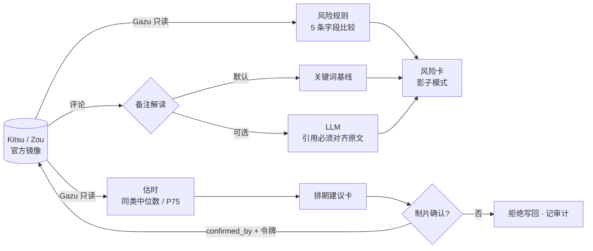

<div align="center">

# 📅 PipeSched · 美术制作排期与进度风险 Agent

*Early prototype: history-based estimates, rule-first delay risk, and confirm-before-writeback on a real Kitsu instance.*


-yellow)


</div>

> [!IMPORTANT]
> **本仓库已由 [ieg-artpipe](https://github.com/felix6328/ieg-artpipe) 取代**，保留作过程记录。ArtPipe 改用开源游戏 0 A.D. 的真实资产和开发历史做评测。

> [!NOTE]
> 个人求职作品（方向：腾讯 IEG · 游戏管理平台产品），**不是**腾讯或任何游戏项目组的生产系统，与腾讯无官方关联。两个 Kitsu 项目里的资产、工时、评论全部由固定种子脚本**合成**（`synthetic`）。

**产品观：** 能从 Kitsu 字段算死的，不交给模型；模型（若启用）只解读规则写不死的评审备注，并且**默认不改档期**。写回必须制片确认。换项目只换 YAML 模板，不换 Agent。

---

## 📑 目录

[背景](#-背景) · [功能](#-功能) · [架构](#-架构) · [实测数字](#-实测数字) · [快速开始](#-快速开始) · [目录结构](#-目录结构) · [设计取舍](#-设计取舍) · [局限](#-局限) · [FAQ](#-faq) · [许可](#-许可)

---

## 🧩 背景

| | |
|---|---|
| **场景** | 制片给美术任务排期、在评审会前找出会延期的任务 |
| **痛点** | 估时拍脑袋；阻塞原因埋在评审备注里；自动工具一旦乱改档期就失去信任 |
| **判断** | 估时用「同任务类型 + 同资产类型」历史；风险规则先行，LLM 只读备注且必须引用原文 |
| **成本** | 规则 + 关键词扫描毫秒级、零费用；149 条评论的 LLM 解读估算 **¥0.05** |
| **安全边界** | 影子模式：只出卡不改状态；写 `start_date` / `due_date` 必须有 `confirmed_by` + 一次性令牌，否则代码层拒绝 |

## ✨ 功能

| 模块 | 说明 |
|---|---|
| 🗓️ 排期建议 | 按模板 DAG 拆工序，同类历史中位数 / P75 估时（检索排除自身），工作日历 + 周产能约束，依赖冲突标红 |
| 🚨 进度风险 | 五条字段规则：逾期、实耗超估、高返修、依赖阻塞、评审 SLA；备注解读需带评论 ID 与原文片段 |
| 🧩 平台化 | 模板 P-Mobile（手游短管线）、P-Character（角色全流程），阈值 / SLA / 默认人天都在 YAML |
| 🔐 写回护栏 | 读写工具分离；令牌哈希存服务端，恒定时间比较；拒绝时 Kitsu 不被调用，审计照记 |

## 🏗️ 架构



## 📊 实测数字

> 部署为**真实官方镜像** `cgwire/cgwire:1.0.79`（Zou API 1.1.2），经 API 建 2 个项目、82 个资产、313 条任务。数据为合成。

**估时**（258 条已完成任务，按完成日前 70% 作检索池、后 30% 测试）

| 方法 | n | MAPE | 中位绝对误差（人天） |
|---|---:|---:|---:|
| **同类中位数（主指标）** | 78 | **0.3527** | 0.4123 |
| 同类 P75（排期保守值） | 78 | 0.5546 | 0.6673 |
| 模板默认（基线） | 78 | 0.4721 | 0.5097 |
| 消融：只按任务类型 | 78 | 0.4597 | 0.7303 |

> [!WARNING]
> 角色项目中位数 MAPE 0.2292 优于模板 0.5257；但**手游项目 0.4828 差于模板 0.4156**——不能说历史检索全面更好。

**回顾式延期预警**（due 前 2 天重建状态，99 条，延期率 0.1414）

| 方案 | Precision | Recall | F1 |
|---|---:|---:|---:|
| 仅规则 | 0.1053 | 0.1429 | 0.1212 |
| 规则 ∪ 关键词 | 0.2000 | 0.4286 | 0.2727 |
| **规则 ∪ LLM** | **0.2609** | **0.4286** | **0.3243** |

整体仍然偏低 → 产品继续走影子模式。

**评论解读**（149 条金标：blocker 36 / sarcasm 18 / misleading 20 / normal 75）

| 方案 | Precision | Recall | F1 | 说明 |
|---|---:|---:|---:|---|
| 关键词基线 | 0.5217 | 1.0000 | 0.6857 | 召回被生成用词抬高，不能外推 |
| **DeepSeek-V3.2 + 护栏** | **0.8780** | 1.0000 | **0.9351** | 反话、误导全部正确拒绝；保守定义下幻觉率 0 |

LLM 单次 P50 3.5 s / P95 10.4 s → 应异步跑；规则扫描离线快照约 0.56 ms。写回：单元测试 28 项通过（1 项 live 跳过），并在真实 Zou 上验证无令牌不改日期。详见 [eval/results.md](eval/results.md) · [eval/badcases.md](eval/badcases.md)。

## 🚀 快速开始

```bash
git clone https://github.com/felix6328/pipesched.git && cd pipesched
python3 -m venv .venv && source .venv/bin/activate
pip install -r requirements.txt
export PYTHONPATH=$PWD

python -m pytest tests/ -q        # 不依赖 Kitsu；含「无确认不得写回」
python eval/measure.py            # 读仓库内冻结快照 data/gold/，离线评测
```

<details>
<summary><b>完整演示：拉起官方 Kitsu → 灌合成数据 → 工作台</b></summary>

```bash
chmod +x scripts/*.sh
./scripts/start_kitsu.sh          # 官方 Kitsu + Zou，端口 8878（约 2 GB 镜像）
# 官方默认演示账号见 https://zou.cg-wire.com/（不是真实凭据）
python scripts/seed.py 42         # 两个合成项目，固定种子，写出 data/gold/ 快照
./scripts/run_app.sh              # 工作台 http://127.0.0.1:8879
```

可选 LLM：在 `.env.local` 中只放 `SILICONFLOW_API_KEY` 一行（加载器只解析这一行）。没有 key 时自动降级为关键词，界面提示「智能解读暂停，规则扫描正常」。

</details>

## 🗂️ 目录结构

```text
pipesched/
├── pipesched/             # 核心包
│   ├── kitsu_client.py    # 只通过 Gazu 读写
│   ├── estimate.py        # 同类历史估时
│   ├── schedule.py        # 关键路径式排期 + 工作日历
│   ├── risk.py            # 五条字段规则
│   ├── comments.py · llm.py · hallucination.py
│   ├── writeback.py       # 确认令牌护栏
│   └── seed.py            # 合成数据生成器
├── app/                   # FastAPI 工作台
├── configs/               # settings + 两套管线模板
├── data/gold/             # 冻结快照与金标
├── eval/                  # 评测脚本与结果
├── scripts/               # 启动 Kitsu、灌数、评测、工作台
├── tests/                 # pytest
└── docs/                  # PRD · DEMO · COST
```

## ⚖️ 设计取舍

| 选择 | 放弃 | 原因 |
|---|---|---|
| 同类中位数 + P75 缓冲 | 精确到小时的预测 | 不足 3 条同类就回退模板并标低置信 |
| 简单关键路径排期 | APS / 多人优化 | 先解决「依据可解释」，再谈最优 |
| 影子模式 | 自动改状态 | 回顾式 Precision 仍低，误报会消耗信任 |
| 旁路官方镜像 | 修改 Kitsu 内核 | 避免 AGPL 义务与升级成本 |

## ⚠️ 局限

- 数据是合成的，工时分布和延期率由生成器设定，不能外推到真实项目组。
- 没有真实制片或 TA 访谈，阈值是初始值。
- 进行中规则 P/R=1 是与生成意图的一致性检查（循环），**不是预测能力**。
- 本环境无法新建 Kitsu 用户，没有多指派、多技能产能；工作日历只跳周末。

## ❓ FAQ

<details>
<summary><b>LLM 的 5 条误报是幻觉吗？</b></summary>

不是。它们的金标是 `normal`（如「原画其实还没定」），引用对齐原文，属于「什么算阻塞」的定义分歧。没有为刷分改金标或提示词。
</details>

<details>
<summary><b>对接 Zou 时踩过哪些坑？</b></summary>

累计实耗在 `duration`（秒），`task.time_spent` 常为 `null`；评论正文在 `text`；`set_time_spent` 单位是秒；删除项目前必须先 `close_project`。
</details>

## 📄 许可

- 代码：[MIT](LICENSE)，© 2026 felix6328。
- Kitsu / Zou 为 AGPL-3.0，本项目旁路使用官方镜像与 API，**未修改内核**；Gazu 为 LGPL-3.0，作为库使用。详见 [NOTICE](NOTICE)。
